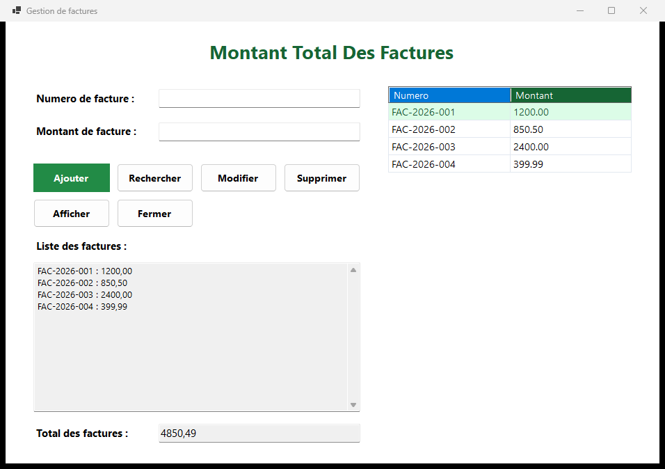

# Invoice Manager

A small Windows Forms application for managing invoices, written in C# to practise data binding and form events. Invoices can be added, edited, deleted and searched, and the list keeps a running total.



## Features

- Add an invoice with a number and an amount, with a duplicate-number check
- Edit or delete the selected invoice
- Search by invoice number
- Running list of invoices and a total for the session
- Accepts French decimal input (comma) and formats amounts with `fr-FR`

## Limitations

Invoices are kept in memory for the session. There is no database or file persistence yet — closing the application clears the list.

## Requirements

- Windows 10/11
- [.NET 8 SDK](https://dotnet.microsoft.com/download)

## Run

```powershell
dotnet run --project appGestionFactures
```

Or open `GestiondesFactures.sln` in Visual Studio 2022 and start the project.

## Structure

| File | Role |
| --- | --- |
| `GestiondesFactures.sln` | Solution file |
| `appGestionFactures/Form1.cs` | Main window: list, add, edit, delete, search, totals |
| `appGestionFactures/Form1.Designer.cs` | Layout of the main window |
| `appGestionFactures/Facture.cs` | Invoice model (number and amount) |
| `appGestionFactures/Program.cs` | Application entry point |

## Author

Ayman Oulhouf — [github.com/AYMANOULHOUF](https://github.com/AYMANOULHOUF)
